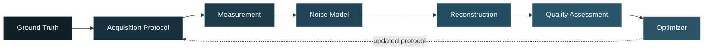

<div align="center">


<br/>

[](https://scantwin.streamlit.app)
[](https://github.com/NeuraMed-AI-Works/scantwin/actions/workflows/tests.yml)
[](LICENSE)
[](https://www.python.org/)

**An Intelligent Digital Twin for Exposure-Aware Optimization of Medical Image Acquisition and Reconstruction**

A research project by **[NEURA MED AI](https://github.com/NeuraMed-AI-Works)**

[Live Demo](https://scantwin.streamlit.app) &nbsp;|&nbsp; [Quick Start](#quick-start) &nbsp;|&nbsp; [Features](#key-features) &nbsp;|&nbsp; [Documentation](#documentation) &nbsp;|&nbsp; [Citation](#citation)

### 👉 [**Try Scantwin live**](https://paperpilot-a4dykv4osjzyhguqsmencn.streamlit.app/) 👈

</div>

<br/>

> [!WARNING]
> **Research and educational prototype.** ScanTwin uses simplified image-acquisition and exposure models. It is **not intended for clinical diagnosis, patient-specific dosimetry, or scanner/protocol prescription.** It reports *relative exposure proxies* and *normalized acquisition costs*, never dose in mSv or Gy, and it performs **no disease classification**. Use only public, de-identified, licensed images. ScanTwin ships no patient data and downloads nothing automatically.

---

## Overview

ScanTwin is a modality-aware digital twin that closes the loop between how an image is acquired and how good the reconstructed image turns out. It simulates the full chain, measures the quality of the result, and searches for the cheapest acquisition protocol that still meets your quality criteria.

Select a modality in the sidebar (**CT, X-ray, MRI, Ultrasound, Other**) and the whole application switches to that modality's simplified physics: protocol controls, labels, live view, optimizer, experiments and learning.



---

## Key Features

<table>
<tr>
<td width="50%" valign="top">

**Multi-Modality Simulation**<br/>
CT, X-ray, MRI and Ultrasound, each with its own simplified acquisition, noise and reconstruction model.

**Live Acquisition View**<br/>
Watch the image form in real time. The final live frame equals the batch result.

**Constraint-Based Optimizer**<br/>
Optuna TPE search returns the cheapest feasible protocol, or states clearly that none exists in the search space.

</td>
<td width="50%" valign="top">

**Learning From Your Own Images**<br/>
A random-forest surrogate predicts SSIM and PSNR from image descriptors and protocol parameters, validated with image-grouped cross-validation.

**Verified Recommendations**<br/>
Every recommendation is re-simulated by the twin through a single authoritative feasibility check.

**Reproducible Experiments**<br/>
Seeded noise, timestamped result folders that are never overwritten, and a validation report generated from real runs.

</td>
</tr>
</table>

---

## Supported Modalities

| Modality | Simplified Model | Cost Proxy (reference = 1.0) |
|:--|:--|:--|
| **CT** | Parallel-beam Radon transform, Beer-Lambert attenuation, Poisson noise, FBP and SART reconstruction | Photon budget and number of views |
| **X-ray** | Line-integral map, Poisson noise, inverse log, post-filter | Photon budget |
| **MRI** | k-space, centre-weighted undersampling, complex noise scaling as 1/sqrt(NEX), zero-filled reconstruction | Scan-time proxy (acceleration R, NEX) |
| **Ultrasound** | Speckle statistics, frame compounding, log compression | Frame count |
| **Other** | Generic CT-style proxy | Same as CT |

Each modality has a "Model scope" box in the app and is documented in [`docs/assumptions.md`](docs/assumptions.md) and [`docs/limitations.md`](docs/limitations.md).

---

## Application Tabs

| # | Tab | Purpose |
|:-:|:--|:--|
| 1 | **Train & Analyze** | Upload your images, train a model (or use the built-in synthetic demo set), then get one result card per test image, a CSV and an optional report |
| 2 | **Digital Twin** | Run one acquisition end to end with metric cards |
| 3 | **Live Acquisition** | Real-time reveal: CT views in golden-angle order, MRI lines centre first, ultrasound frame accumulation, X-ray exposure ramp, slice stream |
| 4 | **Compare** | Reference protocol versus your protocol |
| 5 | **Reconstruction** | Modality-specific reconstruction variants |
| 6 | **Quality vs Cost** | Sweeps of the primary cost parameter |
| 7 | **Optimizer** | Optuna TPE search for the cheapest feasible protocol |
| 8 | **Experiments** | Sweeps saved to `results/<modality>/`, timestamped and never overwritten |
| 9 | **Methodology** | Equations, assumptions and limitations |

---

## Quick Start

### Run Online

No installation needed: **[scantwin.streamlit.app](https://scantwin.streamlit.app)**

> [!NOTE]
> The app is on free hosting and may take a few seconds to wake up after a period of inactivity. Do not upload patient data.

### Run Locally

<details open>
<summary><b>Windows</b></summary>

```bash
git clone https://github.com/NeuraMed-AI-Works/scantwin.git
cd scantwin
python -m venv venv
venv\Scripts\activate
pip install -r requirements.txt
streamlit run app.py
```

`run_app.bat` performs the final step for you.

</details>

<details>
<summary><b>macOS / Linux</b></summary>

```bash
git clone https://github.com/NeuraMed-AI-Works/scantwin.git
cd scantwin
python3 -m venv venv
source venv/bin/activate
pip install -r requirements.txt
streamlit run app.py
```

</details>

### Run the Tests

```bash
pip install -r requirements-dev.txt
pytest
```

> [!TIP]
> `nibabel` (NIfTI) and `pydicom` (DICOM) are optional readers. The app tells you if one is missing.

---

## Learning From Your Own Images

For each image, the digital twin simulates a small protocol grid. A RandomForest then learns SSIM and PSNR from image descriptors and protocol parameters.

- Evaluated with **image-grouped cross-validation** against a mean baseline
- Includes a **novelty check** and a **modality-mismatch warning**
- One model per modality (minimum 3 images, 8 or more recommended); fewer images fall back to a pooled model, which is flagged
- Models are saved as `models/protocol_model_<modality>.joblib`
- A recommendation is shown **only if a twin simulation confirms it** with the single authoritative `is_protocol_feasible`

> [!CAUTION]
> `.joblib` files are Python pickles. Load only model files that you created yourself.

---

## Data

ScanTwin ships no patient data. Built-in sources need no files: Shepp-Logan, concentric disks, a 5-slice synthetic series and a synthetic demo set.

| Format | Notes |
|:--|:--|
| `.dcm` | Requires `pydicom`; converted to HU only when the modality is CT, then a fixed window to [0, 1] |
| `.nii` / `.nii.gz` | Requires `nibabel`; 3D volumes reduced to up to 8 axial slices with one shared intensity mapping |
| `.npy` / `.npz` | 2D slice or 3D stack (max 8 slices); percentile-normalized |
| `.png` `.jpg` `.tif` | 8 or 16-bit; percentile-normalized |

Suggested public sources (you download them yourself): **MedMNIST+** on Zenodo and the **Medical Segmentation Decathlon**. Details and licences are in [`data/README.md`](data/README.md).

---

## Project Structure

```text
scantwin/
├── app.py                 Thin orchestrator (9 tabs)
├── config.py              Reference protocol, default criteria, disclaimer
├── ui/                    Tab modules, sidebar and shared helpers
├── modalities/            Modality interface: CT, X-ray, MRI, Ultrasound
├── digital_twin/          TwinState, DigitalTwin, is_protocol_feasible
├── simulation/            Phantoms, projector, noise models, live acquisition
├── reconstruction/        FBP, SART, reconstruction engine
├── metrics/               SSIM, PSNR, CNR, detectability
├── optimization/          Optuna-based protocol optimizer
├── learning/              Feature extraction, surrogate model, training, reports
├── experiments/           Reproducible sweep and comparison studies
├── scripts/               Validation report and sample-data utilities
├── docs/                  Methodology, equations, assumptions, limitations
├── tests/                 Pytest suite
├── models/  results/  data/
└── .github/               CI workflow, issue and PR templates
```

---

## Technology Stack

<div align="center">


<br/>


</div>

---

## Documentation

| Document | Description |
|:--|:--|
| [`docs/methodology.md`](docs/methodology.md) | Overall approach and pipeline design |
| [`docs/equations.md`](docs/equations.md) | Mathematical formulation |
| [`docs/assumptions.md`](docs/assumptions.md) | Per-modality model assumptions |
| [`docs/limitations.md`](docs/limitations.md) | Known limitations and scope |
| [`docs/validation_report.md`](docs/validation_report.md) | Auto-generated by `scripts/generate_validation_report.py` from real runs on a synthetic phantom; no number is typed by hand |

---

## Honest Status

- Noise levels and default criteria are arbitrary starting values, **not calibrated to any device**.
- No comparison with measured scanner data has been made.
- Quality numbers describe the simulator, not any scanner or patient.

---

## Deploy Your Own Copy

1. Fork this repository.
2. Open [share.streamlit.io](https://share.streamlit.io), sign in with GitHub and choose **Create app**.
3. Select your fork, branch `main`, main file `app.py`, and Python 3.11 under *Advanced settings*.
4. Click **Deploy**. Later pushes to `main` redeploy automatically.

> [!NOTE]
> On the free tier the file system is temporary (saved models and experiment results disappear on reboot), and memory and CPU are limited.

---

## Contributing

Issues and pull requests are welcome. Please read [CONTRIBUTING.md](CONTRIBUTING.md) first. To report a security problem, see [SECURITY.md](SECURITY.md).

## Citation

If you use ScanTwin in academic work, please cite it using [CITATION.cff](CITATION.cff). GitHub also shows a **Cite this repository** button in the sidebar.

```bibtex
@software{scantwin2026,
  title  = {ScanTwin: An Intelligent Digital Twin for Exposure-Aware Optimization of Medical Image Acquisition and Reconstruction},
  author = {{NEURA MED AI}},
  year   = {2026},
  url    = {https://github.com/NeuraMed-AI-Works/scantwin},
  license = {MIT}
}
```

## License

Released under the [MIT License](LICENSE). Copyright (c) 2026 NEURA MED AI.

---

<div align="center">

**NEURA MED AI** builds open, research-oriented projects at the intersection of biomedical engineering and AI.

[More projects](https://github.com/NeuraMed-AI-Works)


</div>
